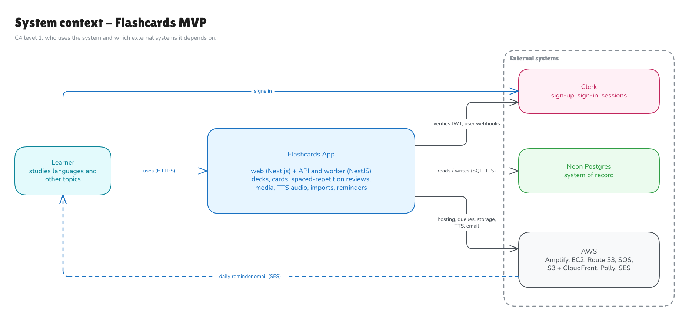
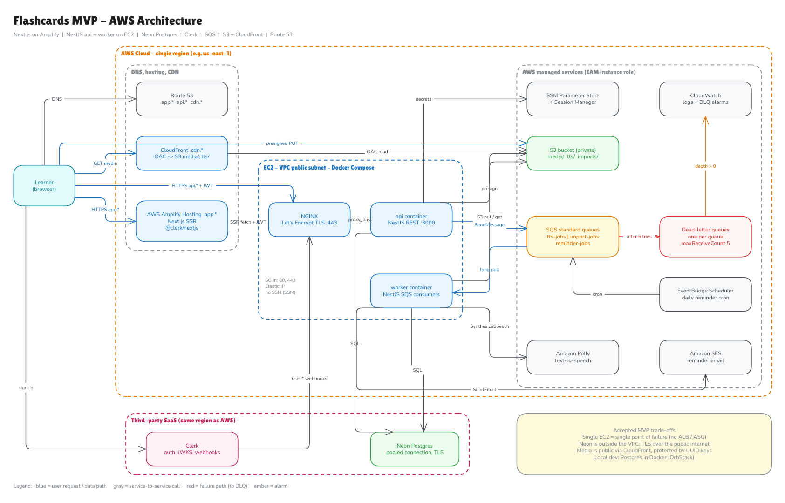
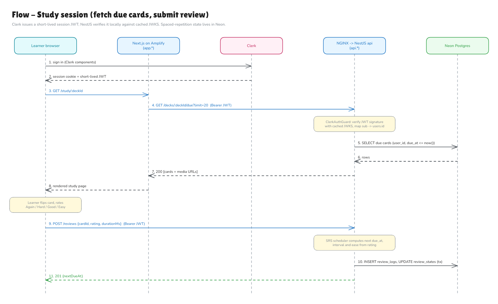
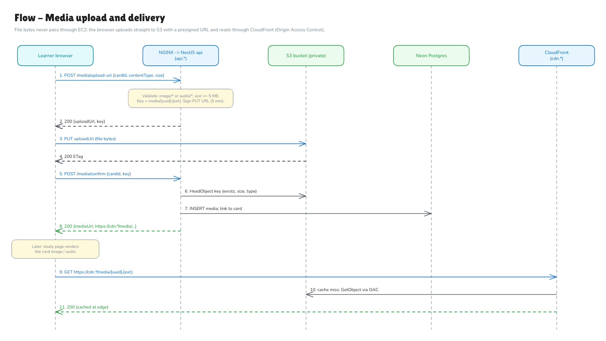
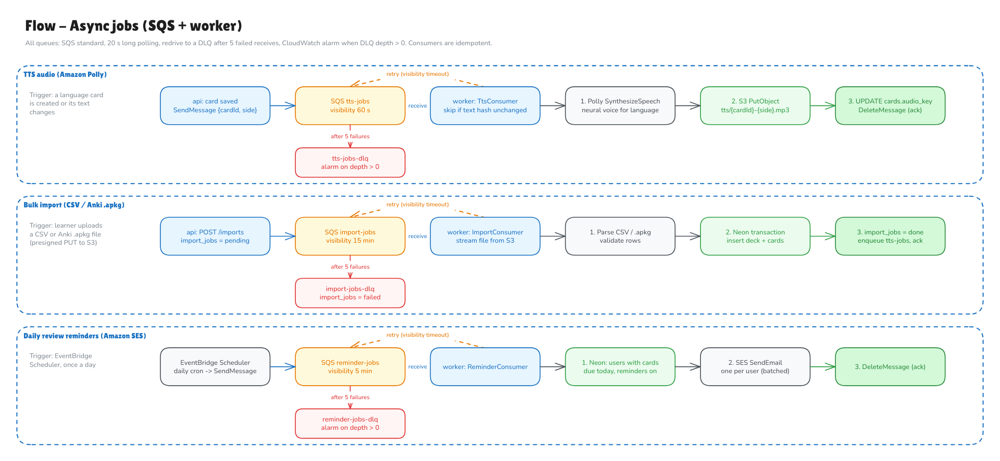
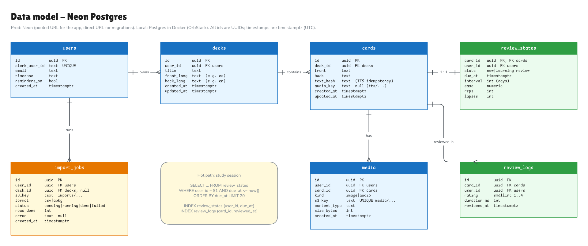
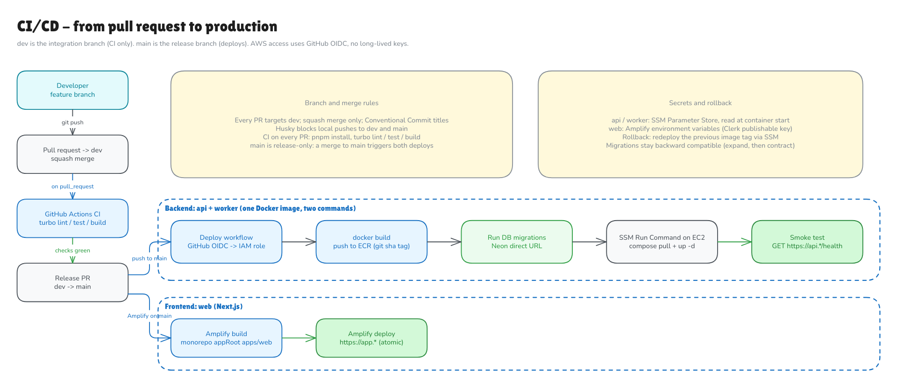

# System design: Flashcards MVP

The MVP architecture for the flashcards app, tracked in issue #8. Every diagram comes in two files:

- `NN-name.png`: the rendered image.
- `NN-name.excalidraw`: the editable source. Open it at <https://excalidraw.com> (File > Open) or in the Excalidraw+ collection `app-flashcards`.

If you change a diagram, re-export both files.

## Diagrams

### 01. System context

Who uses the system and which external systems it depends on (C4 level 1).

### 02. AWS architecture

The deployment view: Route 53, Amplify, the EC2 instance (NGINX, api, worker), SQS with DLQs, EventBridge Scheduler, S3 + CloudFront, Polly, SES, SSM and CloudWatch, plus Neon and Clerk as third-party SaaS.

### 03. Flow: study session

Sign-in with Clerk, fetching due cards, and submitting a review that updates the spaced-repetition state.

### 04. Flow: media upload and delivery

Presigned PUT straight to S3, confirmation through the API, and reads through CloudFront with Origin Access Control.

### 05. Flow: async jobs

The TTS, bulk import and daily reminder pipelines, each with its retry and dead-letter path.

### 06. Data model

Postgres tables and relationships, plus the hot query and its indexes.

### 07. CI/CD

From pull request to production for the backend image and the Amplify-hosted web app.

## Decisions

| Area | Decision | Why |
|---|---|---|
| Frontend hosting | Next.js on **AWS Amplify Hosting** at `app.*` | Managed SSR hosting and builds from git, so there is no web server to run |
| Backend compute | **One EC2 instance** running Docker Compose with `nginx`, `api` and `worker` containers | The cheapest way to run NestJS for an MVP. `api` and `worker` share one image and differ only in their start command |
| TLS / ingress | **NGINX with Let's Encrypt** (certbot) on the instance, reached through an **Elastic IP**. No ALB | Saves the ALB cost. The security group allows inbound 80/443 only, and SSH is replaced by SSM Session Manager |
| Database | **Neon Postgres** in prod, **Postgres in Docker (OrbStack)** locally | Serverless Postgres with branching and nothing to operate. The Neon project sits in the same AWS region as the EC2 instance. The app uses the pooled URL and migrations use the direct URL |
| Auth | **Clerk** | Hosted sign-up, sign-in and sessions. NestJS verifies session JWTs against cached JWKS, and Clerk `user.*` webhooks (Svix-signed) keep the `users` table in sync |
| Async jobs | **SQS standard queues**, one per job type (`tts-jobs`, `import-jobs`, `reminder-jobs`), each with a **DLQ** after 5 failed receives | Job types get their own visibility timeouts (60 s, 15 min, 5 min). Consumers are idempotent, and a CloudWatch alarm fires when a DLQ depth goes above 0 |
| Scheduling | **EventBridge Scheduler** sends one daily message to `reminder-jobs` | Avoids an in-process cron, which would send duplicates once there is more than one instance |
| Media | **S3** (private bucket) with **CloudFront + OAC** at `cdn.*` | Uploads go straight from the browser to S3 with presigned URLs, so file bytes never pass through EC2 |
| Text-to-speech | **Amazon Polly**, called from the worker | Audio is stored at `tts/{cardId}-{side}.mp3` and keyed by a text hash, so it is only regenerated when the text changes |
| Email | **Amazon SES** for review reminders | Clerk only sends auth emails |
| DNS | **Route 53**: `app.*` points to Amplify, `api.*` to the Elastic IP, `cdn.*` to CloudFront | One hosted zone for the domain |
| Secrets | **SSM Parameter Store** for api and worker, **Amplify environment variables** for web | Nothing secret lives in the repo or the Docker image |
| CI/CD | **GitHub Actions** CI on every PR to `dev`. A merge to `main` builds the image, pushes it to **ECR**, runs migrations and redeploys through **SSM Run Command**. Amplify builds `main` on its own | AWS access uses GitHub OIDC, with no long-lived keys |

## Accepted trade-offs

- **The single EC2 instance is a single point of failure.** There is no ALB or Auto Scaling group, so deploys and instance failures cause brief downtime. To scale out later: add an ALB, run two or more instances in an ASG, and switch TLS to ACM on the ALB.
- **Neon is outside the VPC.** Database traffic crosses the public internet over TLS. Keeping Neon in the same AWS region keeps latency low. Neon scales to zero, so the first query after an idle period has a cold start.
- **Media is public through CloudFront, protected only by unguessable UUID keys.** If private decks need stronger protection, switch to CloudFront signed URLs or signed cookies.

## Open questions

- Spaced-repetition algorithm: SM-2 or FSRS. The `review_states` columns cover both.
- ORM and migration tool for NestJS.
- AWS region and domain name.
