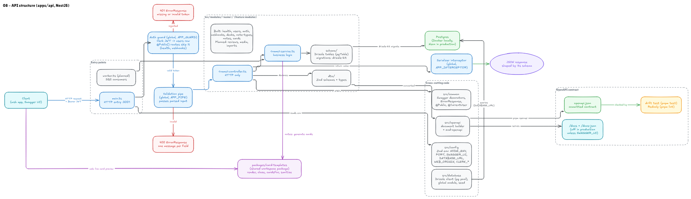
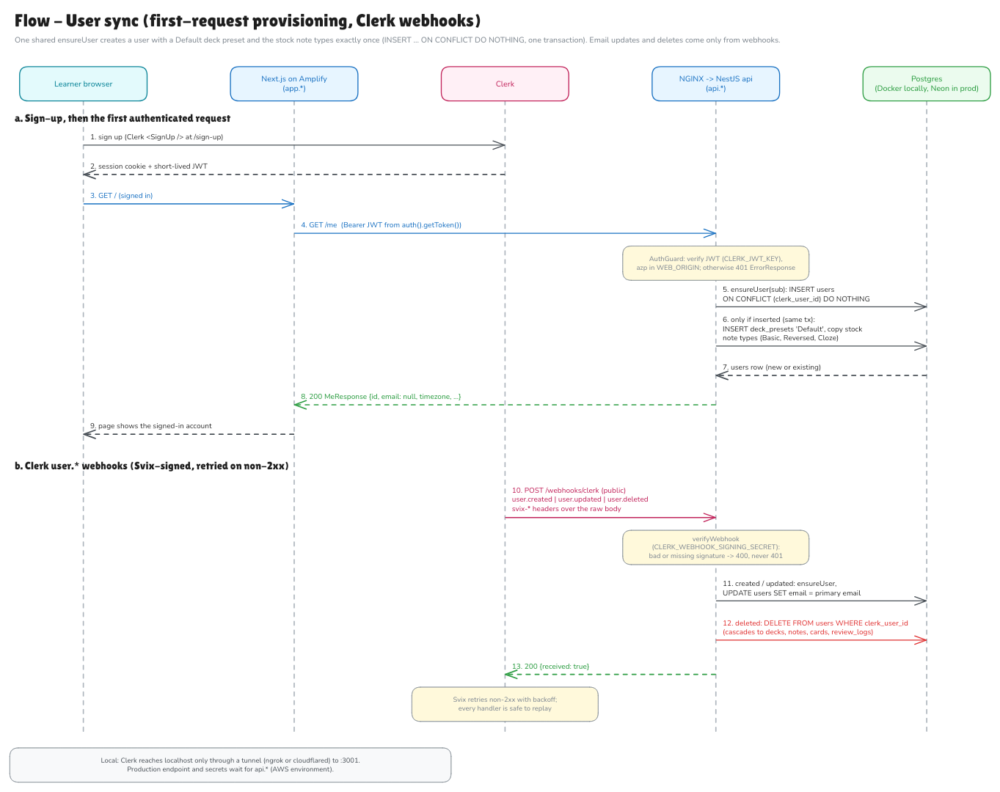

# System design: Flashcards MVP

The MVP architecture for the flashcards app, tracked in issue #8. Every diagram is edited in its Excalidraw+ scene, `NN-name` in the Excalidraw+ collection `app-flashcards`, and the repo holds two files exported from that scene:

- `NN-name.png`: the rendered image, exported from the scene screenshot.
- `NN-name.excalidraw`: the scene content, exported from the scene. Open it for viewing at <https://excalidraw.com> (File > Open).

To change a diagram, edit its Excalidraw+ scene through the Excalidraw+ MCP, check it with a screenshot, then re-export both files from the scene. Never edit or render the files here directly (see "Diagram conventions" in `CLAUDE.md`).

## Diagrams

### 01. System context

Who uses the system and which external systems it depends on (C4 level 1).

### 02. AWS architecture

The deployment view: Route 53, Amplify, the EC2 instance (NGINX, api, worker), SQS with DLQs, EventBridge Scheduler, S3 + CloudFront, Polly, SES, SSM and CloudWatch, plus Neon and Clerk as third-party SaaS.

### 03. Flow: study session

Sign-in with Clerk, fetching due cards, and submitting a review that updates the spaced-repetition state.

### 04. Flow: media upload and delivery

Presigned PUT straight to S3, confirmation through the API, and reads through CloudFront with Origin Access Control.

### 05. Flow: async jobs

The TTS, bulk import and daily reminder pipelines, each with its retry and dead-letter path.

### 06. Data model

The 13 Postgres tables, in four groups:
- content, modeled on Anki: note types with their fields and card templates, notes and decks with option presets;
- study: cards carrying the FSRS scheduling state, and the append-only `review_logs`;
- media and TTS: `media`, `note_media` and the shared `tts_clips` cache;
- jobs: `import_jobs`.

It also shows the table conventions and the partial indexes behind the study queues.

### 07. CI/CD

From pull request to production for the backend image and the Amplify-hosted web app, plus the versioning lane that tags each app on pushes to `dev` and `main`.

### 08. API structure

How the NestJS API is organized inside its container:
- the entry points (`main.ts` now, `worker.ts` planned);
- the global request pipeline: auth guard (a Clerk session JWT, or 401 `ErrorResponse`; `@Public()` routes skip it), then validation pipe, then controller and service, then serializer interceptor;
- the feature modules in `src/modules/<name>/` (health, users, auth, webhooks, decks, note-types, notes and cards built; reviews, media and imports planned);
- the shared workspace package `packages/card-templates`, which the `notes` module uses to generate cards and the web app uses for its live card preview;
- the cross-cutting code in `src/config` (including `WEB_ORIGIN` and the `CLERK_*` variables), `src/common` (including `@Public()` and `@CurrentUser()`), `src/openapi` and `src/database` (the Drizzle client);
- the Drizzle tables in each module's `schema/`, applied to Postgres with `drizzle-kit` migrations;
- the committed OpenAPI contract, `apps/api/openapi.json`, with the checks that keep it current.

### 09. Flow: user sync

How a Clerk account becomes a `users` row, and how Clerk changes reach it:
- **first authenticated request:** the auth guard verifies the session JWT and calls `ensureUser`, which runs `INSERT ... ON CONFLICT (clerk_user_id) DO NOTHING` and, only for a new user, creates the "Default" deck preset and copies the stock note types in the same transaction. Sign-up never waits for a webhook;
- **Clerk webhooks:** `POST /webhooks/clerk` verifies the Svix signature (400, never 401, when it fails). `user.created` and `user.updated` run the same `ensureUser` and set the primary email, and `user.deleted` deletes the user, which cascades to everything they own. Svix retries non-2xx, and every handler is safe to replay;
- locally, Clerk reaches the API only through a tunnel; the production endpoint waits for `api.*`.

## Decisions

| Area | Decision | Why |
|---|---|---|
| Frontend hosting | Next.js on **AWS Amplify Hosting** at `app.*` | Managed SSR hosting and builds from git, so there is no web server to run |
| Backend compute | **One EC2 instance** running Docker Compose with `nginx`, `api` and `worker` containers | The cheapest way to run NestJS for an MVP. `api` and `worker` share one image and differ only in their start command |
| TLS / ingress | **NGINX with Let's Encrypt** (certbot) on the instance, reached through an **Elastic IP**. No ALB | Saves the ALB cost. The security group allows inbound 80/443 only, and SSH is replaced by SSM Session Manager |
| Database | **Neon Postgres** in prod, **Postgres 18 in Docker** (`compose.yaml`, OrbStack) locally and for tests | Serverless Postgres with branching and nothing to operate. The Neon project sits in the same AWS region as the EC2 instance. The app uses the pooled URL and migrations use the direct URL. Locally, one `docker compose up -d --wait db` starts the app database and `flashcards_test` |
| Content model | **Note types, notes and cards**, as in Anki. A note type has fields and card templates with stable IDs; a note holds field values keyed by field key; each template, or each cloze deletion, gives one card. Built-in note types (Basic, Basic (and reversed), Cloze) are copied into each user's account | Reversed cards, cloze, user-defined note types and faithful `.apkg` imports need no rewrite of `cards`. Stable field keys mean renaming or reordering fields never rewrites notes |
| Scheduler | **FSRS only**. The scheduling state (state, due date, stability, difficulty, step, reps, lapses) lives on `cards`, and `review_logs` stores the state before and after every review | Anki's default scheduler since 23.10. Full review history lets FSRS parameters be tuned per user and lets a review be undone; history that isn't recorded can't be recovered |
| ORM and migrations | **Drizzle** (0.45, pinned exactly) with SQL migrations generated by `drizzle-kit`, reviewed and committed. Tables live in each module's `schema/`. Never `drizzle-kit push` | TypeScript tables fit the per-module layout, and the committed SQL makes every schema change reviewable. Moving to Drizzle 1.0 later is a `drizzle-kit up` |
| Table conventions | UUIDv7 IDs from the app (`uuidv7()` as the database default), `user_id` on every user-owned row with composite foreign keys `(x_id, user_id)`, NO ACTION for "in use" references, `timestamptz`, text with `CHECK` for enumerations, hard deletes except that review logs outlive their card | The database itself stops a row from pointing at another user's data. Time-ordered IDs keep large indexes compact. The same `user_id` column is the hook for row-level security or sharding later |
| Sharing | **Copy on subscribe**: a shared deck is copied into the subscriber's account, as Anki does | Every row keeps a single owner, so permissions stay `WHERE user_id = me`. Author updates can reach copies later through an `upstream_note_id` column and a sync job |
| Auth | **Clerk** | Hosted sign-up, sign-in and sessions. A global NestJS guard verifies session JWTs (networkless with `CLERK_JWT_KEY`, `azp` checked against `WEB_ORIGIN`) and every route needs one unless marked `@Public()`. Accounts are provisioned on the first request: one shared `ensureUser` creates the user, the "Default" deck preset and the stock note types exactly once, from either the first authenticated request or `user.created`, so sign-up never waits for a webhook. Email updates and deletes come only from Clerk `user.*` webhooks (Svix-signed) |
| Async jobs | **SQS standard queues**, one per job type (`tts-jobs`, `import-jobs`, `reminder-jobs`), each with a **DLQ** after 5 failed receives | Job types get their own visibility timeouts (60 s, 15 min, 5 min). Consumers are idempotent, and a CloudWatch alarm fires when a DLQ depth goes above 0 |
| Scheduling | **EventBridge Scheduler** sends one daily message to `reminder-jobs` | Avoids an in-process cron, which would send duplicates once there is more than one instance |
| Media | **S3** (private bucket) with **CloudFront + OAC** at `cdn.*` | Uploads go straight from the browser to S3 with presigned URLs, so file bytes never pass through EC2 |
| Text-to-speech | **Amazon Polly**, called from the worker | Audio is content-addressed: `tts_clips` is keyed by the hash of language, voice and text, and the file lives at `tts/{hash}.mp3`. Every user studying the same text in the same voice shares one file, and nothing is regenerated unless the text changes |
| Email | **Amazon SES** for review reminders | Clerk only sends auth emails |
| DNS | **Route 53**: `app.*` points to Amplify, `api.*` to the Elastic IP, `cdn.*` to CloudFront | One hosted zone for the domain |
| Secrets | **SSM Parameter Store** for api and worker, **Amplify environment variables** for web | Nothing secret lives in the repo or the Docker image |
| CI/CD | **GitHub Actions** CI on every PR to `dev`. Feature PRs are squash-merged into `dev`; release PRs `dev -> main` are merged with a **merge commit**. A merge to `main` builds the image, pushes it to **ECR**, runs migrations and redeploys through **SSM Run Command**. Amplify builds `main` on its own | AWS access uses GitHub OIDC, with no long-lived keys. Merge commits keep every `dev` commit in `main`'s history, so release PRs show only what is new |
| Versioning | `api` and `web` are versioned **independently** with Semantic Versioning, stored **only as git tags** (`<app>@X.Y.Z`) with GitHub Releases. The `versioning` workflow tags each app that `turbo ls --affected` reports on a push to `dev` with `<app>@X.Y.Z-dev.N` (bump from the commit type), and on a push to `main` promotes the latest dev version to `<app>@X.Y.Z` | The turbo graph catches shared-package, lockfile and root-config changes. No bot commits, so the `dev`/`main` rulesets need no bypass. Tags created with `GITHUB_TOKEN` don't trigger other workflows, so future deploy jobs must run in the same workflow or use `workflow_run` |
| API layout | NestJS **feature modules** in `apps/api/src/modules/<name>/` (`<name>.module.ts`, `.controller.ts`, `.service.ts`, `dto/`, plus `schema/` for the module's Drizzle tables). Cross-cutting code lives in `src/config`, `src/common`, `src/openapi` and `src/database`, and an architecture test enforces the layout, including that tables are only defined in `schema/` | Every MVP feature gets the same predictable home. Controllers stay HTTP-only and services hold the logic, without the ceremony of per-module ports and adapters |
| API validation | **Zod 4 through Nest 12's built-in Standard Schema support**: `@Body/@Query/@Param({ schema })`, a global `StandardSchemaValidationPipe` (400 with one message per field) and a global `StandardSchemaSerializerInterceptor` that shapes responses. No `class-validator`, `class-transformer` or `nestjs-zod` | One schema gives the TypeScript type, the validation, the response shape and the OpenAPI schema. `nestjs-zod` doesn't support Nest 12, and `class-transformer` has had no release since 2022 |
| API contract | **OpenAPI 3.1 generated from the code** (`@nestjs/swagger` 12 with `zod-openapi`) and committed as `apps/api/openapi.json`. A drift test and Redocly lint keep it current and complete. Swagger UI is at `/docs`, off in production unless `SWAGGER_UI=true` | The contract is reviewable in PRs and can't silently drift from the code or lose documentation. Only body and response schemas are named components, because Swagger doesn't expand a named query schema into parameters |
| Shared code | **Workspace packages under `packages/`**, pure TypeScript with no I/O, built by `tsc` to `dist/` and imported by both apps. The first is `card-templates` | Rules that the API and the web app must apply identically (how notes become cards, how field HTML is sanitized) live and are tested in one place, so the two can never disagree. Built output works unchanged for `nest build`, Node at runtime, Vitest and Next.js |
| Web UI | **Tailwind v4 and shadcn/ui** with the "Paper" tokens from the approved prototype (`design/decks-and-cards/prototype.html`): Fraunces headings, Geist body, warm neutrals, terracotta for due and green for new. Light, dark and system themes. Every screen is checked at 375 px and 1280 px in both themes. The web app calls the API only from the Next.js server (Server Components and Server Actions) | One component library and one token source keep screens consistent. Server-side calls keep the session token and the API URL out of browser code and need no CORS for the web app |
| Note content | **Notes are what users write; cards are derived.** A standard note type makes one card per template whose front renders non-empty, a cloze note type one card per `{{cN::}}` number. Editing a note can add cards but never deletes one. Field HTML is sanitized to bold, italic, underline and line breaks on every write and before display; template HTML is rendered only in a sandboxed iframe | Anki's model, so imports keep their structure. Never deleting cards on edit keeps review history. The allowlist makes field content safe to render, and the sandbox contains template HTML, which will come from imported note types |

## Accepted trade-offs

- **The single EC2 instance is a single point of failure.** There is no ALB or Auto Scaling group, so deploys and instance failures cause brief downtime. To scale out later: add an ALB, run two or more instances in an ASG, and switch TLS to ACM on the ALB.
- **Neon is outside the VPC.** Database traffic crosses the public internet over TLS. Keeping Neon in the same AWS region keeps latency low. Neon scales to zero, so the first query after an idle period has a cold start.
- **Media is public through CloudFront, protected only by unguessable UUID keys.** If private decks need stronger protection, switch to CloudFront signed URLs or signed cookies.
- **The shared `tts_clips` cache outlives account deletion.** Clips are keyed by content and have no owner, so deleting a user leaves the audio of their text in the cache. Each clip records `last_used_at`, and a cleanup job deletes clips nobody has used for N days.
- **A deleted account can come back empty.** After `user.deleted`, a session token that is still valid (up to its about 60 s lifetime) or a late Svix retry of `user.created` makes `ensureUser` create the account again, with a "Default" preset and the stock note types but no content. Clerk revokes sessions on delete, so the window is short. A delete marker checked by `ensureUser` closes it if it ever matters.
- **Three references are checked in code, not by the database.** `review_logs.card_id`, `review_logs.deck_id` and `import_jobs.deck_id` must become NULL when their target is deleted. A composite foreign key with plain SET NULL would also null `user_id`, and Drizzle can't express Postgres's column-list `SET NULL (col)`, so these are single-column foreign keys. The services that write them look targets up by `user_id`.

## Data model growth path

The schema is built so that each later Anki-style feature adds tables or columns and never rewrites an existing table:

| Feature | How it fits |
|---|---|
| Users edit note types and templates | Editor UI only; `note_types`, `note_type_fields` and `card_templates` already hold user-owned rows with stable IDs |
| Shared decks and author updates | Copy on subscribe, plus a `notes.upstream_note_id` column and a sync job |
| Filtered or custom study decks | A `filtered_decks` table and a `cards.original_deck_id` column |
| Hierarchical tags and tag rename | Keep `notes.tags text[]` with `array_replace`, or add a `tags` table |
| Browser search | A generated `tsvector` column on `notes.sort_field` with a GIN index |
| Offline and mobile sync | `updated_at` is already on every table that changes; add a tombstones table for deletes |
| `review_logs` grows large | Partition by month; time-ordered UUIDv7 IDs help |
| Statistics | Rollup tables built from `review_logs` |
| Row-level security | Policies on `user_id`, which every user-owned row already has |

## Open questions

- AWS region and domain name.
- Does Neon offer Postgres 18 in the chosen region? If not, drop the SQL `uuidv7()` default; every insert through Drizzle already sets the ID in the app.
